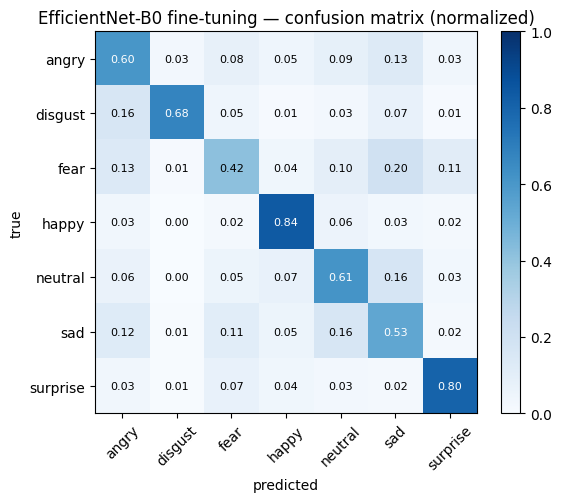
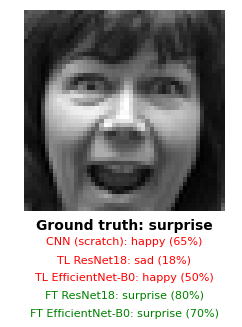

# facial-emotion-recognition

A computer vision project for facial emotion classification using the FER2013 dataset. This project explores multiple deep learning models and training strategies, compares their performance, and exports the best-performing model, **fine-tuned EfficientNet-B0**, to ONNX format for inference.

## Table of Contents

- [Project Overview](#1-project-overview)
- [Problem Description](#2-problem-description)
- [Dataset and Models Used](#3-dataset-and-models-used)
- [Workflow and Architecture](#4-workflow-and-architecture)
- [Results and Evaluation](#5-results-and-evaluation)
- [Technologies Used](#6-technologies-used)
- [How to Run the Project](#7-how-to-run-the-project)
- [Future Improvements](#8-future-improvements)
- [Acknowledgment](#9-acknowledgment)

## 1. Project Overview

Facial Emotion Recognition (FER) is a computer vision task that identifies human emotions from facial images.

The goal of this project is to develop and evaluate deep learning models that classify facial expressions into seven emotion categories. Several model architectures and training strategies were explored to identify the best-performing approach.

The final selected model is **EfficientNet-B0 with fine-tuning**, which was exported to ONNX format for deployment-oriented inference.

**Emotion classes:**

`angry`, `disgust`, `fear`, `happy`, `neutral`, `sad`, and `surprise`.

## 2. Problem Description

Facial emotion classification is challenging because facial images may have low resolution, lighting variations, partial occlusions, and visually similar expressions. Additionally, the dataset contains an imbalanced distribution of emotion classes.

This project addresses the task by training and comparing different deep learning models and evaluating their performance using classification accuracy, Macro-F1 score, per-class metrics, and confusion matrices.

## 3. Dataset and Models Used

### Dataset: FER2013

The project uses the FER2013 (Facial Expression Recognition 2013) dataset.

- **Source:** [FER2013 on Kaggle](https://www.kaggle.com/datasets/msambare/fer2013)
- **Dataset identifier:** `msambare/fer2013`
- **Task:** Seven-class facial emotion classification
- **Original image resolution:** 48 × 48 pixels
- **Image type:** Grayscale
- **Dataset structure:** Separate training and test directories organized by emotion class

### Dataset Splitting

The original training set was divided into training and validation subsets using stratified sampling.

| Setting | Value |
|---|---|
| Validation split | 15% of the original training set |
| Splitting strategy | Stratified sampling |
| Random seed | 42 |
| Test set | Original test set, kept separate for final evaluation |
| Batch size | 128 |

The validation set was used for model selection and early stopping. The original test set was used for final model evaluation.

### Models Evaluated

The following models and training approaches were explored:

1. **CNN from Scratch** — a convolutional neural network trained from scratch.
2. **EfficientNet-B0 — Transfer Learning** — a pretrained model adapted for seven-class emotion classification.
3. **ResNet — Transfer Learning** — a pretrained ResNet model adapted for the classification task.
4. **EfficientNet-B0 — Fine-Tuning** — a pretrained EfficientNet-B0 model fine-tuned for the target dataset.
5. **ResNet — Fine-Tuning** — a pretrained ResNet model fine-tuned for the target dataset.

### Image Preprocessing

Two preprocessing pipelines were implemented.

**From-scratch model:**
- Convert images to grayscale with one channel.
- Apply random horizontal flipping.
- Apply random rotation up to 10 degrees.
- Apply random affine transformations with translation and scaling.
- Convert images to tensors.
- Normalize using mean `0.5` and standard deviation `0.5`.
- Apply random erasing with probability `0.2` during training.

**Pretrained models:**
- Convert grayscale images to three channels.
- Resize images to `128 × 128` pixels.
- Apply random horizontal flipping and random rotation during training.
- Normalize using ImageNet mean `[0.485, 0.456, 0.406]` and standard deviation `[0.229, 0.224, 0.225]`.

Validation and test images use the corresponding evaluation transforms without training augmentation.

## 4. Workflow and Architecture

The project follows these main steps:

1. Download FER2013 from Kaggle using `kagglehub`.
2. Load the dataset using `torchvision.datasets.ImageFolder`.
3. Split the original training set into training and validation subsets using stratified sampling.
4. Apply the appropriate preprocessing pipeline for each model.
5. Train and compare the selected CNN, EfficientNet-B0, and ResNet configurations.
6. Use class-weighted cross-entropy loss to help address class imbalance.
7. Select the best checkpoint based on validation accuracy.
8. Apply early stopping and learning rate scheduling during training.
9. Evaluate the models on the original test set.
10. Export the selected fine-tuned EfficientNet-B0 checkpoint to ONNX.
11. Compare PyTorch and ONNX Runtime outputs to verify numerical consistency.

### ONNX Model Export

The final exported model is **fine-tuned EfficientNet-B0**.

| Property | Value |
|---|---|
| Architecture | EfficientNet-B0 |
| Training approach | Fine-tuning |
| Number of classes | 7 |
| Input name | `image` |
| Input shape | `[batch_size, 3, 128, 128]` |
| Input data type | FP32 (`float32`) |
| Output name | `logits` |
| Output shape | `[batch_size, 7]` |
| ONNX opset version | 17 |
| Batch dimension | Dynamic |
| ONNX filename | `emotion_effnetb0_fp32.onnx` |
| Inference runtime | ONNX Runtime |
| Verification provider | CPU Execution Provider |

The model expects preprocessed input tensors. During inference, images must be converted to three grayscale channels, resized to `128 × 128`, converted to tensors, and normalized using the same ImageNet statistics used during evaluation.

The model outputs raw logits for the seven emotion classes. Softmax can be applied to obtain normalized class probabilities.

### ONNX Verification

The exported ONNX model is loaded using ONNX Runtime, and its output is compared with the corresponding PyTorch model output using the maximum absolute difference.

This comparison checks numerical consistency for the tested input. It does not independently measure classification accuracy.

## 5. Results and Evaluation

### Model Comparison

The following table compares the evaluated models. Replace the placeholders with the actual results obtained from the training notebook.

| Model | Training Approach | Test Accuracy (%) | Macro-F1 (%) |
|---|---|---:|---:|
| CNN | From Scratch | 60.70% | 56.70% |
| EfficientNet-B0 | Transfer Learning | 44.71% | 39.71% |
| ResNet | Transfer Learning | 43.24% | 37.32% |
| EfficientNet-B0 | Fine-Tuning | 64.80% | 62.91% |
| ResNet | Fine-Tuning | 62.18% | 60.67% |

### Best Performing Model

**Selected Model: EfficientNet-B0 with Fine-Tuning**

EfficientNet-B0 with fine-tuning was selected as the final model for ONNX export based on the experiments conducted in this project.

| Evaluation Metric | Result |
|---|---|
| Test Accuracy | 64.80% |
| Macro-F1 Score | 62.91% |
| Best Validation Accuracy | 64.4%|
| ONNX/PyTorch Maximum Absolute Difference | 4.7683716e-06 |

### Visual Results

**1. Model Comparison**


**2. Training and Validation Curves**


**3. Confusion Matrix**



**4. Additional Results**



### Evaluation Metrics

The evaluation pipeline reports:

- **Accuracy:** Overall proportion of correctly classified images.
- **Macro-F1 Score:** Average F1 score across all seven classes, treating each class equally.
- **Classification Report:** Per-class precision, recall, and F1 score.
- **Confusion Matrix:** Normalized matrix showing classification performance across emotion classes.

## 6. Technologies Used

- **Programming Language:** Python
- **Deep Learning:** PyTorch, Torchvision
- **Data Processing:** NumPy, Pandas
- **Machine Learning Utilities:** Scikit-learn
- **Visualization:** Matplotlib
- **Dataset Download:** KaggleHub
- **Model Interoperability:** ONNX
- **Inference Runtime:** ONNX Runtime
- **Development Environment:** Google Colab, if used for training

## 7. How to Run the Project

### Requirements

- Python environment with the required packages installed.
- Kaggle API credentials if requested by KaggleHub.
- CUDA-enabled GPU recommended for faster training; CPU execution is also supported by the training code.

### Installation

Install the required dependencies:

```bash
pip install kagglehub torch torchvision scikit-learn pandas numpy matplotlib onnx onnxruntime
```

### Execution Steps

1. Open the project notebook in Google Colab or a compatible Python environment.
2. If using Google Colab, enable GPU acceleration through **Runtime → Change runtime type → T4 GPU**, when available.
3. Configure Kaggle API credentials if required.
4. Run the notebook cells in order to download the dataset and inspect the data.
5. Run the preprocessing and data-splitting steps.
6. Train the models and compare their validation performance.
7. Evaluate the models on the original test set.
8. Ensure the intended fine-tuned EfficientNet-B0 checkpoint is available.
9. Run the ONNX export code to generate `emotion_effnetb0_fp32.onnx`.
10. Verify the exported model using ONNX Runtime.

The notebook uses a `SAVE_DIR` variable to store checkpoints, results, and the exported ONNX file. Make sure the directory is configured correctly before training and exporting.

### Inference

For inference using the exported model:

1. Load `emotion_effnetb0_fp32.onnx` with ONNX Runtime.
2. Preprocess the input image using the same evaluation transforms.
3. Run inference using the input name `image`.
4. Interpret the seven output logits using the emotion class order defined by the training dataset.
5. Apply softmax if class probabilities are required.

## 8. Future Improvements

- Improve classification performance on underrepresented emotion classes.
- Explore additional data augmentation and class-balancing techniques.
- Tune hyperparameters and compare alternative model architectures.
- Benchmark inference latency and model size.
- Evaluate ONNX predictions on real test images against PyTorch predictions.
- Explore ONNX quantization and other inference optimizations.
- Develop a simple interface for image-based emotion prediction.
- Investigate model robustness under different lighting conditions, poses, and partial occlusions.

## 9. Acknowledgment

This project was completed as part of the **Computer Vision Systems Development** training program at [SDAIA Academy](https://github.com/SDAIAAcademy).

---

*This project was developed for educational and training purposes as part of the program.*
